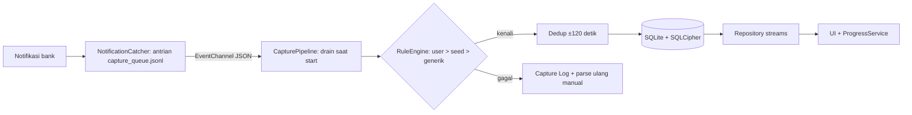

# Arsitektur Bukuduit

Pencatat keuangan pribadi Android, offline-first. Transaksi dari push
notifikasi bank/e-wallet tertangkap otomatis; semua data tersimpan
terenkripsi di perangkat, tanpa server. Dokumen ini ringkas — rincian
alasan tiap keputusan ada di [`decisions/`](decisions/).

## Prinsip

1. **Offline-first, privasi tanpa kompromi.** Tanpa server, tanpa
   analytics, tanpa izin jaringan untuk data. SQLCipher + passphrase di
   secure storage ([ADR-002](decisions/002-enkripsi-lokal-tanpa-server.md)).
2. **Native hanya transport.** Seluruh logika (parse, dedup, simpan) di
   Dart, unit-testable tanpa device
   ([ADR-001](decisions/001-native-transport-only.md)).
3. **Engine murni di bawah, UI di atas.** `core/` dan `rules/engine`
   bebas dependensi drift/Flutter; storage dan UI memakainya
   ([ADR-003](decisions/003-engine-murni.md)).

## Peta lapisan

| Lapisan | Isi | Aturan |
|---|---|---|
| Native (Kotlin) | `MainActivity.kt`, `NotificationCatcher` | Baca notifikasi → JSON mentah → antrian file + EventChannel. Tidak parse, tidak putuskan apa pun. |
| Capture | `lib/capture/` | Drain antrian, filter paket sendiri, mode pelajaran, fallback capture log, hook progress. |
| Rules | `lib/rules/`, `assets/rules/seed_rules.json` | Parse teks notifikasi → draft transaksi. Murni Dart. |
| Core | `lib/core/` | Money (int rupiah), buckets tren, budget (`LimitLine`/`BudgetSnapshot`), format tanggal ID. Murni Dart, tanpa drift/Flutter. |
| Storage | `lib/storage/` | Drift schema v8, SQLCipher, `LedgerRepository` satu-satunya akses data. |
| Game | `lib/game/` | `ProgressService`: streak, mood maskot, alert/pemulihan/milestone. |
| UI | `lib/ui/`, `lib/theme/` | Shell 4-tab + design system Quest. Konsumsi stream + ChangeNotifier, tanpa library state management. |

## Alur capture

- Antrian file membuat notifikasi tidak hilang saat app mati.
- Notifikasi yang gagal parse disimpan mentah di Capture Log; setelah
  rules diperbaiki, entri lama bisa di-parse ulang tanpa transaksi ulang.
- Setiap transaksi tercatat (capture maupun manual) memicu
  `ProgressService.onTransactionRecorded()` → deteksi garis batas naik
  level / pulih / milestone streak, realtime.

## Prioritas rules

1. **User rules** (tabel `user_rules`, diedit di layar Aturan) —
   keputusan user selalu menang; pattern custom bersifat eksklusif.
2. **Seed rules** (`assets/rules/seed_rules.json`) — template per bank.
   Dimaterialisasi ke `user_rules` sekali saat bootstrap agar bisa
   dinonaktifkan/diubah per user.
3. **Template generik** (`unknown`) — pola in/out umum untuk app tak
   dikenal.

## Model data (drift schema v8)

| Tabel | Isi |
|---|---|
| `transactions` | Transaksi: uuid, arah, nominal, kategori, akun, jenis, pihak, sumber (manual/capture), waktu |
| `categories` | Kategori + warna; hapus → transaksi pindah ke fallback "Lainnya" |
| `accounts` | Akun (blu, Nagari, Tunai bawaan + tambahan), jenis, saldo awal |
| `budgets` | Alokasi bulanan per kategori, opsional di-scope ke akun |
| `app_settings` | Batas harian/mingguan/bulanan, marker restore, mode pelajaran |
| `bons` | Utang-piutang: arah, nominal, pihak, status lunas |
| `capture_logs` | Notifikasi mentah + status parse; bahan tuning rules |
| `user_rules` | Rules capture milik user (hasil materialisasi seed + buatan sendiri) |

Migrasi v1→v8 self-heal: tabel/kolom yang hilang dibuat ulang, broken
v2 diperbaiki, kategori/akun ter-seed, backfill dijalankan di
`beforeOpen`. v8 memensiunkan Target/Sisihkan: tabel `targets` dan
`target_deposits` di-drop (ADR-009).

## Konvensi

- **Uang**: int rupiah penuh (`Money`); desimal koma dipotong ke bawah.
- **Periode**: `[start, end)` eksklusif ujung atas; waktu lokal device.
- **Tren**: bucket mingguan 7-hari, menjadi bulanan bila rentang >62
  hari (maks 24 bucket).
- **Streak**: dihitung ulang dari data transaksi asli setiap refresh —
  bukan counter tersimpan, tidak bisa drift. Belum mencatat hari ini
  tidak memutus.
- **Mood maskot**: fungsi murni kondisi — over → khawatir, warning →
  idle/waspada, ok + catat hari ini → senang, tanpa data → idle,
  streak 0 → mengantuk
  ([ADR-007](decisions/007-gamifikasi-berbasis-kondisi.md)).
- **Stream disematkan**: `StreamBuilder`/`FutureBuilder` memakai objek
  stream/future yang disematkan sekali per umur `State` (`initState` +
  buat ulang di `didUpdateWidget` bila param berubah) — jangan dibuat
  inline di `build`. Objek baru tiap rebuild memicu subscribe ulang →
  skeleton berkedip setiap pindah tab.

## Keputusan kunci

| ADR | Keputusan |
|---|---|
| [001](decisions/001-native-transport-only.md) | Native hanya transport JSON mentah + antrian file |
| [002](decisions/002-enkripsi-lokal-tanpa-server.md) | SQLCipher lokal, tanpa server/cloud |
| [003](decisions/003-engine-murni.md) | Core + rules bebas drift/Flutter |
| [004](decisions/004-prioritas-rules.md) | User rules > seed > generik |
| [005](decisions/005-dedup-120-detik.md) | Dedup push ganda ±120 detik |
| [006](decisions/006-restore-dua-fase.md) | Restore via staging + marker + restart |
| [007](decisions/007-gamifikasi-berbasis-kondisi.md) | Gamifikasi = cermin kondisi nyata; XP/level dihapus |
| [008](decisions/008-quest-design-system.md) | Design system Quest sendiri, tanpa state library |
| [009](decisions/009-pensiun-target-sisihkan.md) | Target/Sisihkan dipensiunkan; Rencana = Batas, belanja murni tunggal |

## Pengujian

115 test, 10 file: rule engine (seed + user + fallback), budget, progress/
streak/mood, repository (dedup, saldo, migrasi, alokasi), money, buckets,
rekap filter, CSV, history.
UI sengaja belum punya widget test — logika dipagari di engine murni
sesuai prinsip 3.
