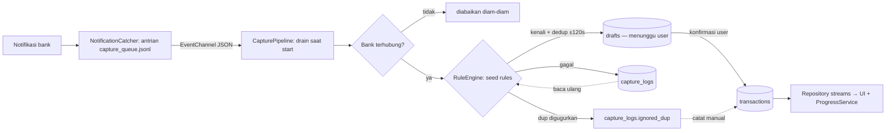

# Arsitektur Bukuduit

Pencatat keuangan pribadi Android, offline-first. Transaksi dari push
notifikasi bank/e-wallet tertangkap otomatis; semua data tersimpan
terenkripsi di perangkat, tanpa server. Dokumen ini ringkas — rincian
alasan tiap keputusan ada di [`decisions/`](decisions/).

## Prinsip

1. **Offline-first, privasi tanpa kompromi.** Tanpa server, tanpa
   analytics, tanpa izin jaringan untuk data. SQLCipher + passphrase di
   secure storage ([ADR-002](decisions/002-enkripsi-lokal-tanpa-server.md)).
2. **Native hanya transport.** Seluruh logika (parse, dedup, simpan) di
   Dart, unit-testable tanpa device
   ([ADR-001](decisions/001-native-transport-only.md)).
3. **Engine murni di bawah, UI di atas.** `core/` dan `rules/engine`
   bebas dependensi drift/Flutter; storage dan UI memakainya
   ([ADR-003](decisions/003-engine-murni.md)).

## Peta lapisan

| Lapisan | Isi | Aturan |
|---|---|---|
| Native (Kotlin) | `MainActivity.kt`, `NotificationCatcher` | Baca notifikasi (lewati ongoing) → JSON mentah → antrian file terbatas + EventChannel. Tidak parse, tidak putuskan apa pun. |
| Capture | `lib/capture/` | Drain antrian (tahan baris korup), filter bank terhubung, antrean pemrosesan berurutan, fallback capture log. |
| Rules | `lib/rules/`, `assets/rules/seed_rules.json` | Parse teks notifikasi → draf transaksi. Seed rules murni, murni Dart. |
| Core | `lib/core/` | Money (int rupiah), buckets tren, budget (`LimitLine`/`BudgetSnapshot`), format tanggal ID. Murni Dart, tanpa drift/Flutter. |
| Storage | `lib/storage/` | Drift schema v11, SQLCipher, `LedgerRepository` satu-satunya akses data. |

## Alur capture

- Antrian file membuat notifikasi tidak hilang saat app mati; ukurannya
  dibatasi (±1 MB, disimpan 1000 baris terakhir) dan notifikasi ongoing
  (musik/unduhan) dilewati.
- **Allowlist paket (amandemen ADR-001, audit A-02):** hanya paket bank
  terhubung yang boleh ditulis ke antrean disk — notifikasi app lain
  (OTP, chat) tak pernah menyentuh storage. Sink live tetap menerima
  semuanya; bank yang cocok lewat keyword dengan paket asing
  "dipelajari" (`learnBankPackage`) lalu diantrikan sejak saat itu.
- Baris antrian yang korup dilewati — satu baris rusak tidak membuang
  antrean lainnya.
- Notifikasi yang gagal parse disimpan mentah di Capture Log; setelah
  rules diperbaiki, entri lama bisa di-parse ulang tanpa transaksi ulang.
- Duplikat yang digugurkan dedup tidak senyap: tercatat dengan penanda
  `ignored_dup` dan tampil di Diagnostik (catat manual / hapus);
  log terbaca/dup >30 hari dipangkas otomatis.
- Setiap transaksi tercatat (konfirmasi draf maupun manual) memicu
  `ProgressService.onTransactionRecorded()` → deteksi garis batas naik
  level / pulih / milestone streak, realtime.

## Rules & model hubungkan bank

Model "hubungkan bank" (menggantikan user rules, ADR-004 digantikan):

1. User menghubungkan bank/e-wallet dari katalog (`connected_banks`
   di `app_settings`); hanya notifikasi bank terhubung yang diproses,
   selebihnya diabaikan diam-diam.
2. Seed rules (`assets/rules/seed_rules.json`) — template per bank,
   dipakai murni tanpa lapisan user rules.
3. Template generik (`unknown`) — pola in/out umum sebagai fallback
   bank yang dikenali tapi formatnya belum ada.

Hasil parse selalu menjadi **draf** menunggu keputusan user — tidak
pernah auto-catat. Timpa perilaku parsing dilakukan lewat loop
capture log → perbaiki seed → parse ulang, bukan aturan per-user.

**Mode Belajar & Multi-Kanal** (2026-10-31):
1. **App Apa Pun**: App bank/e-wallet apa pun bisa dihubungkan dari daftar app terpasang (disimpan `app:<paket>` di `custom_banks`). Notifikasi tak dikenal menjadi draf mentah dengan tebakan pola umum (`RuleEngine.guess`).
2. **Tempel Teks**: Notifikasi, SMS, atau email disalin-tempel manual di layar Notifikasi → draf instan.
3. **Tarik Notifikasi Aktif**: Tombol di Diagnostik menarik notifikasi status bar yang masih tayang (`getActiveNotifications`).
4. **Tujuan Share**: Android `ACTION_SEND` (teks & gambar) dari WhatsApp/email/galeri langsung masuk ke alur tempel teks atau OCR.
5. **OCR Struk On-Device**: ML Kit Latin recognizer on-device (100% offline) membaca foto kamera / galeri struk belanja / bukti transfer dengan koreksi teks & nominal interaktif.

## Model data (drift schema v11)

| Tabel | Isi |
|---|---|
| `transactions` | Transaksi: uuid, arah, nominal, kategori, akun, jenis, pihak, sumber (manual/capture), waktu |
| `drafts` | Draf hasil capture bank terhubung — menunggu konfirmasi/dibuang; tak masuk saldo/laporan |
| `categories` | Kategori + warna; hapus → transaksi pindah ke fallback "Lainnya" |
| `accounts` | Akun (blu, Nagari, Tunai bawaan + tambahan), jenis, saldo awal, tautan `bank_id` |
| `budgets` | Alokasi bulanan per kategori, opsional di-scope ke akun |
| `app_settings` | Batas harian/mingguan/bulanan, marker restore, bank terhubung |
| `bons` | Utang-piutang: arah, nominal, pihak, status lunas |
| `capture_logs` | Notifikasi mentah + status parse + penanda `ignored_dup`; bahan tuning rules |

Migrasi v1→v11 self-heal (v11: index occurred_at): tabel/kolom yang hilang dibuat ulang, broken
v2 diperbaiki, kategori/akun ter-seed, backfill dijalankan di
`beforeOpen`. v8 memensiunkan Target/Sisihkan (ADR-009); v9 menambah
draf + tautan akun↔bank; v10 membuang `user_rules` dan menambah
`capture_logs.ignored_dup`.

## Konvensi

- **Uang**: int rupiah penuh (`Money`); desimal koma dipotong ke bawah.
- **Periode**: `[start, end)` eksklusif ujung atas; waktu lokal device.
- **Tren**: bucket mingguan 7-hari, menjadi bulanan bila rentang >62
  hari (maks 24 bucket).
- **Streak**: dihitung ulang dari data transaksi asli setiap refresh —
  bukan counter tersimpan, tidak bisa drift. Belum mencatat hari ini
  tidak memutus.
- **Mood maskot**: fungsi murni kondisi — over → khawatir, warning →
  idle/waspada, ok + catat hari ini → senang, tanpa data → idle,
  streak 0 → mengantuk
  ([ADR-007](decisions/007-gamifikasi-berbasis-kondisi.md)).
- **Stream disematkan**: `StreamBuilder`/`FutureBuilder` memakai objek
  stream/future yang disematkan sekali per umur `State` (`initState` +
  buat ulang di `didUpdateWidget` bila param berubah) — jangan dibuat
  inline di `build`. Objek baru tiap rebuild memicu subscribe ulang →
  skeleton berkedip setiap pindah tab.

## Keputusan kunci

| ADR | Keputusan |
|---|---|
| [001](decisions/001-native-transport-only.md) | Native hanya transport JSON mentah + antrian file |
| [002](decisions/002-enkripsi-lokal-tanpa-server.md) | SQLCipher lokal, tanpa server/cloud |
| [003](decisions/003-engine-murni.md) | Core + rules bebas drift/Flutter |
| [004](decisions/004-prioritas-rules.md) | ~~User rules > seed > generik~~ — digantikan model hubungkan bank (seed murni) |
| [005](decisions/005-dedup-120-detik.md) | Dedup push ganda ±120 detik |
| [006](decisions/006-restore-dua-fase.md) | Restore via staging + marker + restart |
| [007](decisions/007-gamifikasi-berbasis-kondisi.md) | Gamifikasi = cermin kondisi nyata; XP/level dihapus |
| [008](decisions/008-quest-design-system.md) | Design system Quest sendiri, tanpa state library |
| [009](decisions/009-pensiun-target-sisihkan.md) | Target/Sisihkan dipensiunkan; Rencana = Batas, belanja murni tunggal |
| [010](decisions/010-palet-dari-piksel-maskot.md) | Palet turunan piksel maskot Pochy |
| [011](decisions/011-notasi-tanda-nominal.md) | Tanda arah nominal digambar minimalis (bukan seberat angka) |

## Pengujian

159 test, 16 file: rule engine (seed + fallback), budget, progress/
streak/mood, repository (dedup, saldo, migrasi v1→v11, alokasi, log
lifecycle), pipeline (draf, dedup, baris korup, allowlist paket, tempel teks,
notifikasi aktif), OCR struk/nota, money, buckets, rekap filter, history —
plus 6 file widget test komponen Quest (motion, nav, segmented, tab directional,
transisi, layout laporan). Alur layar penuh tetap tanpa widget test — logika
dipagari di engine murni sesuai prinsip 3.
